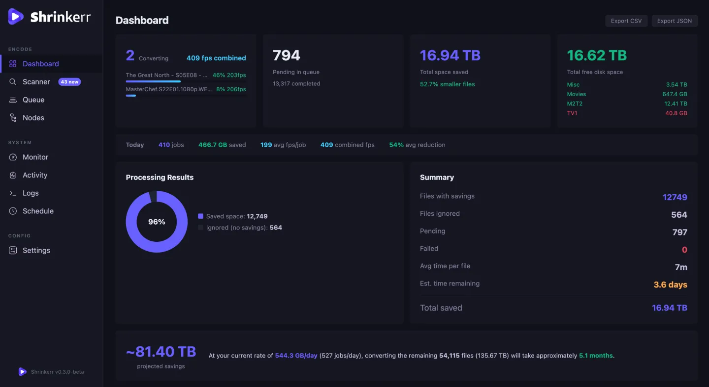

<div align="center">


**Save space, bandwidth & money while retaining quality.**

[](https://github.com/I-IAL9000/shrinkerr/actions/workflows/build-images.yml)
[](https://github.com/I-IAL9000/shrinkerr/releases)

[](LICENSE)

</div>

---

Shrinkerr makes a video library smaller without making it worse. It converts
films and episodes to HEVC (or AV1), removes the audio and subtitle tracks you
don't want, and replaces a file only when the new one passes its checks.

- **It knows your languages.** It keeps the languages you choose plus each
  title's original language, from TMDB, so a Japanese film keeps its Japanese
  audio. Tracks with no language tag are identified, by listening to the
  audio or reading the subtitles, and the fix is written into the file.
- **It converts disc rips.** Blu-ray and DVD folders and ISOs become one MKV.
- **It checks before it replaces.** A new file has to be complete, still HDR
  if the original was, smaller, and good enough by its VMAF score. Originals
  can be kept for days, and Undo puts one back
  ([what happens to your files](docs/what-happens-to-your-files.md)).

Converted files usually come out 40–65% smaller. Across the maintainer's
library, that's about **40–50 TB saved for every 100 TB**.

It works with Sonarr, Radarr, Bazarr, Plex, Jellyfin and Emby, encodes on
NVIDIA, Intel, AMD and Apple hardware or the CPU, and can share the work with
other machines.

<div align="center">



</div>

> 📚 **[Full documentation in `/docs`](docs/README.md)** — installation
> scenarios, encoding guide, remote-worker setup, rules & automation,
> best practices, troubleshooting, FAQ.

## Features

**Converting**
- HEVC by default, or AV1 for the files a rule picks.
- NVENC on NVIDIA, Quick Sync and VAAPI on Intel / AMD (*experimental*),
  VideoToolbox on a Mac (native install), or the CPU (libx265, SVT-AV1). See
  [Hardware](docs/hardware.md).
- Five quality presets, from Max quality to Smallest, for every encoder, with
  its own quality per resolution and per kind of content (anime, film grain,
  animation, remuxes).
- [VMAF](https://github.com/Netflix/vmaf) checks: reject encodes below a
  score, or target a score and let each title find its own quality.
- HDR10 and HLG stay HDR; Dolby Vision profiles 7 and 8 keep their Dolby
  Vision.
- Blu-ray and DVD folders and ISOs convert to one MKV.
- A test encode on a sample before you commit, and before / after frames of
  every conversion.
- Savings estimates before you queue anything, which learn from your own
  conversions.

**Audio and subtitles**
- Keep the languages you choose plus each title's original language; tracks
  you keep or remove by hand stay that way.
- Lossless audio converted to a smaller codec (Atmos and DTS:X stay
  lossless), and an optional stereo compatibility track, loudness-normalised
  if you like.
- Image subtitles (PGS, VobSub) converted to SRT with OCR; external `.srt` /
  `.ass` files merged into the file.
- Untagged tracks identified from the subtitle text, the audio (Whisper) or
  the subtitle images (OCR), and the language written into the file
  ([Language detection](docs/language-detection.md)).
- Direct-play filters find what makes Plex, Jellyfin and Emby transcode, and
  **Fix for direct play** fixes it.

**Your library**
- A Scanner with filters for nearly everything — codec, resolution, HDR,
  bitrate for the resolution, audio and subtitle details, hardlinked
  (seeding), not watched in months, below Sonarr / Radarr's cutoff, leaving
  soon in Maintainerr — that combine, plus Advanced Search. Save any of them
  as a view, one click away in the sidebar.
- Poster view with TMDB artwork and IMDb links, and each file's technical
  details.
- Health checks, and replacing corrupt files through Sonarr / Radarr.
- Batch rename with Plex-friendly patterns.

**Automation**
- Rules by folder, source, resolution, codec, content type, size, Sonarr /
  Radarr tags, Plex / Jellyfin / Emby labels, collections, genres and watched
  status, or a saved view. A rule can change the encoder, quality, AV1,
  languages, what happens to originals and the minimum VMAF. Share rules as
  YAML, start from the rule library, and test which rule a file gets.
- New files queued by the watcher, Sonarr / Radarr's Connect webhook, or the
  NZBGet / SABnzbd scripts, optionally after a wait so Bazarr adds subtitles
  first.
- Policies run a saved view on a schedule within a budget ("up to 200 GB each
  night"); **Free space…** picks the conversions that free N GB fastest.
- Run hours, and a pause while Plex, Jellyfin or Emby is streaming.
- **Review before replace**, post-conversion scripts and custom ffmpeg flags.
- Sonarr, Radarr, Bazarr, Plex, Jellyfin and Emby are told about every
  changed file.

**Remote workers**
- More machines share the work, each with its own encoder; the Nodes page
  writes the command to start one.
- Jobs go to a node that can run them; per-node schedules, affinity and
  parallel jobs; path mappings; a node that keeps failing is paused.

**Keeping an eye on it**
- Dashboard, statistics and a system monitor (GPU, CPU, disks, streams).
- Notifications by Discord, Telegram, email, webhook, ntfy, Gotify or
  Apprise (100+ services), including a weekly summary.
- Prometheus metrics, a Homepage / Homarr widget, and Home Assistant over
  MQTT ([Monitoring](docs/monitoring.md)).
- A **Doctor** page that checks the setup and makes a diagnostics file for
  bug reports.

**Safety**
- Sign-in is required: a password, or your reverse proxy's. Apps use API
  keys.
- Originals kept for N days, trashed or deleted, as you choose; Undo while
  they're kept. Hardlinked files are left alone.
- Settings export / import and database backups.

**Interface**
- English and Spanish; light, dark or your system's theme; works on phones,
  from the keyboard and with a screen reader.
- A setup wizard that previews your language choices on your own files.

---

## Requirements

- **Docker 20.10+** with **Docker Compose V2** (the built-in `docker compose` subcommand, not legacy `docker-compose`)
- **Media library** on a filesystem Docker can bind-mount with read + write access
- **Port 6680** free on the host (or another port of your choosing)
- **For NVENC (optional, 5–10× faster than CPU)**:
  - NVIDIA GPU: Pascal (GTX 10xx) or newer for 10-bit HEVC, the default; a second-generation Maxwell GPU (GTX 950 and up) can do 8-bit HEVC (Settings → Video → Bit Depth)
  - NVIDIA driver 570+ (for both `:nvenc` and `:edge-nvenc`)
  - **Linux**: [NVIDIA Container Toolkit](https://github.com/NVIDIA/nvidia-container-toolkit)
  - **Windows**: Docker Desktop in WSL2 mode (Windows 10 21H2+ / Windows 11) with a recent NVIDIA Windows driver — nothing else to install
  - **macOS**: no NVIDIA path, but Apple's **VideoToolbox** hardware encoder is supported when Shrinkerr runs **natively (no Docker)**, as a server or as a remote worker. See [Running Shrinkerr natively on macOS](docs/native-install-mac.md). Real-world: ~30–100 fps native vs. ~1 fps via Docker.

Which encoders work on which hardware, and which image to use: [Hardware](docs/hardware.md). On a NAS: [Unraid, TrueNAS and Synology](docs/nas.md).

---

## Image variants

Four tags are published to two registries — pick whichever you prefer:

- [`ghcr.io/i-ial9000/shrinkerr`](https://github.com/I-IAL9000/shrinkerr/pkgs/container/shrinkerr) — GitHub Container Registry (no rate limits on anonymous pulls)
- [`pal9000/shrinkerr`](https://hub.docker.com/r/pal9000/shrinkerr) — Docker Hub (mirror; familiar default. Docker Hub limits anonymous pulls — if you hit the limit, pull from GHCR or sign in to Docker Hub)

Both registries publish the same tags simultaneously:

| Tag | Platforms | Encoding | When to use |
|---|---|---|---|
| `:latest` | linux/amd64 + linux/arm64 | libx265 (CPU only) | **Default.** Works on Mac, Windows, Linux, Raspberry Pi, ARM cloud. Pick this unless you specifically want GPU. |
| `:edge` | linux/amd64 + linux/arm64 | libx265 (CPU only) | Same as `:latest` but with a bleeding-edge ffmpeg master build. Not a pre-release of Shrinkerr — that's `:develop`. |
| `:nvenc` | linux/amd64 | NVENC + libx265 | NVIDIA GPU host on Linux or Windows+WSL2. ffmpeg n8.1, needs driver 570+. |
| `:edge-nvenc` | linux/amd64 | NVENC + libx265 | NVIDIA GPU host running a very recent driver. ffmpeg master, needs driver 570+. |

**Release channels and versions.** Every variant comes in these flavours (shown for `:latest`; add `-nvenc`, `-edge` or `-edge-nvenc`):

| Tag | Changes when | For |
|---|---|---|
| `:latest` | a new release, every few weeks | most people |
| `:0.10` | a patch to 0.10 (security and data-loss fixes) | patches without new features |
| `:v0.10.0` | never | pinning a version |
| `:develop` | every change | testers — shows a `-dev` version, hears about newer develop builds, expect the occasional rough edge |
| `:v0.11.0-rc.1` | never | trying a release before it's out |

Shrinkerr tells you in the sidebar when a new version is out (for a `:develop` image, a newer develop build); it never updates itself. See [Upgrading](docs/installation.md#upgrading) for update tools and moving back to an older version.

**All variants share the same database schema and settings format** — you can switch between them with a single `image:` line change and a `docker compose pull && docker compose up -d`. The app's runtime capability detection handles the encoder difference transparently.

The compose snippets below use `ghcr.io/...`; substitute `pal9000/shrinkerr:<tag>` if you prefer Docker Hub.

---

## Quick start

### Option A — Portable (works on any host, CPU encoding)

This is the recommended starting point, even on a GPU host, because it lets you validate the setup before layering on NVENC.

```yaml
# docker-compose.yml
services:
  shrinkerr:
    image: ghcr.io/i-ial9000/shrinkerr:latest
    container_name: shrinkerr
    ports:
      - "6680:6680"
    volumes:
      - ./data:/app/data                 # Shrinkerr's SQLite DB + history
      - /srv/media:/media                # YOUR media library (read + write)
    environment:
      - PUID=1000                        # optional: run as this user/group instead of root,
      - PGID=1000                        # e.g. the same as Sonarr / Radarr / Plex
    restart: unless-stopped
```

```bash
docker compose up -d
```

Open <http://localhost:6680>. Shrinkerr first asks you to set up sign-in (a username and password, or your reverse proxy's), then the setup wizard walks you through the rest. Change sign-in later in **Settings → System → Authentication**.

### Option B — With NVENC (Linux + NVIDIA GPU)

```yaml
services:
  shrinkerr:
    image: ghcr.io/i-ial9000/shrinkerr:nvenc
    container_name: shrinkerr
    ports:
      - "6680:6680"
    volumes:
      - ./data:/app/data
      - /srv/media:/media
    environment:
      - NVIDIA_VISIBLE_DEVICES=all
    restart: unless-stopped
    runtime: nvidia                      # Linux with NVIDIA Container Toolkit
    deploy:
      resources:
        reservations:
          devices:
            - driver: nvidia
              count: all
              capabilities: [gpu, compute, video, utility]
              # gpu      — claim a GPU device (meta capability)
              # compute  — CUDA libs (some downstream libs need it)
              # video    — NVENC + NVDEC hardware encode/decode
              # utility  — nvidia-smi + NVML (drives the GPU
              #            utilization / temp / VRAM panels in
              #            the Monitor page)
              # Drop `utility` and the encode still works but the
              # Monitor page can't show GPU stats — see the
              # troubleshooting entry below.
```

**Windows (Docker Desktop WSL2)**: same file, but **remove** the `runtime: nvidia` line. Docker Desktop doesn't register a `nvidia` runtime by name; the `deploy:` block is the cross-platform way.

A heavily-commented production template is at [`docker-compose.portainer.yml`](docker-compose.portainer.yml) — copy it, adjust the paths, and paste into Portainer.

---

## First-time setup

After you set up sign-in, the setup wizard walks you through six steps: media folders, hardware (the encoder), quality, the languages to keep, what happens to originals, and a first scan. Then it opens the Scanner. Reopen it any time at `/?setup`.

To do the same by hand:

1. **Add media directories** — Settings → Media → Media Directories. Point at `/media/TV`, `/media/Movies`, etc. (whatever paths exist inside the container mount).
2. **Scan your library** — Scanner → select paths → Scan. Shrinkerr probes each file with ffprobe and classifies it.
3. **Connect Plex (optional)** — Settings → Integrations → Plex. Enables label-based rules and automatic library refresh.
4. **Start converting** — Queue → Start. Jobs run 1 at a time by default; the Nodes page lets you bump this to match your hardware.

You can skip 3 and go straight to manual encoding via Scanner → Add to queue.

## Intel/AMD GPU support (experimental)

> ⚠️ **Experimental** — confirmed end-to-end on one tester's modern
> Intel iGPU (Ubuntu 24.04, ~145 fps QSV / ~190 fps VAAPI on 1080p
> HEVC) as of v0.3.92, but we don't have data from a wide enough
> hardware spread (older Coffee Lake iGPUs, AMD GPUs, Arc /
> Battlemage) to call them stable. **If you try them, please
> [open an issue](https://github.com/I-IAL9000/shrinkerr/issues) with
> a quick "works on Intel UHD 630, Debian 12, 50 GB → 22 GB" or "fails
> with X" — that's how we expand the supported matrix.**

Both Docker images (`:latest` CPU and `:nvenc`) ship with the VA-API
runtime (amd64 only) as of v0.3.67. To activate the encoders, the host needs to
pass through `/dev/dri` and add the container user to the render
group:

```yaml
services:
  shrinkerr:
    devices:
      - /dev/dri:/dev/dri
    group_add:
      - video
      # numeric GID of the host group that owns /dev/dri/renderD128.
      # Find with: stat -c '%g' /dev/dri/renderD128
      - "110"
```

After `docker compose down && up -d`, Settings → Video → Default
Encoder will surface QSV / VAAPI options if the host hardware supports
them. Click *Re-detect* if your existing tab opened before passthrough
was active.

| Encoder | Hardware | When to use |
|---|---|---|
| **QSV** (`hevc_qsv`) | Intel iGPUs (Gen8+ / 2014+), Intel Arc / Battlemage | Best on Intel — better quality controls than VAAPI on the same hardware |
| **VAAPI** (`hevc_vaapi`) | Intel iGPUs (any) AND AMD GPUs (Polaris / Vega / RDNA) | The only hardware path for AMD; works on Intel too |
| **NVENC** | NVIDIA GPUs: Pascal or newer for 10-bit (the default), second-generation Maxwell (GTX 950 and up) for 8-bit | Use the `:nvenc` image variant; doesn't go through `/dev/dri` |

Verify with `docker exec shrinkerr vainfo` — should list HEVC encode
profiles (e.g. `VAProfileHEVCMain`). If it errors with `vaInitialize
failed`, the render node likely belongs to a different vendor's
driver (e.g. nvidia-drm); see the troubleshooting section in
`docs/installation.md`.

---

## Workflows

<details>
<summary><b>Encode a library</b></summary>

1. **Scanner** → pick directories → **Scan**. Takes 5-30 minutes per 10k files depending on disk speed.
2. Filter by codec (show x264 only), by resolution (1080p+), by size, or by any attribute via the search bar / advanced filter panel.
3. Select a subset → **Add to queue**. An estimate modal shows expected space saved + estimated time.
4. **Queue** → **Start**. Shrinkerr encodes in the background and updates the UI live via WebSocket.
5. Files are replaced in place. Originals go to `.shrinkerr_backup` (or the trash, or permanently deleted — configurable).

</details>

<details>
<summary><b>Audio/subtitle cleanup</b></summary>

Many Blu-ray rips ship with 5+ audio tracks (commentary, descriptive audio, foreign-language dubs) and 20+ subtitle tracks. Shrinkerr can strip the ones you don't want without re-encoding video.

1. **Settings → Audio & subtitles** — set your "always keep" languages (e.g. `eng, isl`) and optionally ignore unknown-language tracks. For subtitles, also tick **Remove unwanted subtitle tracks** (off on new installs; the setup wizard ticks it when you pick subtitle languages).
2. Scanner flags files with removable tracks.
3. Add to queue → Shrinkerr runs an ffmpeg stream-copy (fast, no quality loss) with the unwanted tracks dropped.

</details>

<details>
<summary><b>Sonarr/Radarr — request a replacement</b></summary>

For a corrupt or low-quality file already on disk:

1. Scanner → expand the file → **Request replacement** (or **Re-request all** on the Queue's Failed tab).
2. Shrinkerr blocklists the current release in Sonarr/Radarr, deletes the file from disk, and triggers a fresh search.
3. Or use **Search for upgrades** / **Search missing episodes** as bulk actions across a directory.

</details>

<details>
<summary><b>NZBGet / SABnzbd integration</b></summary>

Auto-queue freshly-downloaded releases so they start encoding the moment the download finishes, before Sonarr/Radarr import them.

1. Settings → Integrations → NZBGet / SABnzbd → **Download NZBGet Script** (or SABnzbd).
2. Drop the downloaded script into your downloader's scripts folder.
3. Your server URL and API key are baked in — no further config.

Files with nzb-assigned categories / Sonarr/Radarr tags you configure in the Shrinkerr UI will be queued automatically after the download completes.

</details>

<details>
<summary><b>Distributed encoding — add a worker node</b></summary>

Offload encoding to a second machine (gaming PC, idle NUC, ARM server).

1. On the main server: Settings → System → Authentication → copy the **API Key**.
2. On the worker host, deploy the same image in worker mode:

   ```yaml
   services:
     shrinkerr-worker:
       image: ghcr.io/i-ial9000/shrinkerr:latest    # or :nvenc for a GPU worker
       environment:
         - SHRINKERR_MODE=worker
         - SERVER_URL=http://<main-host-ip>:6680
         - API_KEY=<paste-the-key-here>
         - WORKER_NAME=gaming-pc
         - CAPABILITIES=nvenc,libx265               # advertise what this box can do
         # If the worker sees the library at a different path than the server:
         # - PATH_MAPPINGS=[{"server":"/media","worker":"/mnt/nas"}]
       volumes:
         - /mnt/nas:/media                          # must match PATH_MAPPINGS or the server's path
       restart: unless-stopped
   ```

3. `docker compose up -d`. The worker registers itself and appears on the Nodes page within 30 seconds.

NVENC workers need the same GPU passthrough config as the main server (`runtime: nvidia` + `deploy:` devices on Linux).

</details>

---

## Configuration

### Environment variables

| Variable | Default | Purpose |
|---|---|---|
| `SHRINKERR_DB_PATH` | `/app/data/shrinkerr.db` | SQLite database file path |
| `SHRINKERR_MEDIA_ROOT` | `/media` | Container-side root of the media library |
| `SHRINKERR_MODE` | `server` | Set to `worker` to run as a remote worker node |
| `PUID` / `PGID` | unset (root) | Run as this user / group instead of root, so the files Shrinkerr writes are owned like your other apps' (e.g. `1000`). The data folder is handed to that user on start. |
| `UMASK` | unset | File-creation mask for the files Shrinkerr writes (e.g. `002`) |
| `NVIDIA_VISIBLE_DEVICES` | unset | Set to `all` on NVENC variants to enable GPU passthrough |
| `SHRINKERR_LANG_DETECT_AUDIO_MIN` | `0.6` | Min confidence to accept an audio [language detection](docs/language-detection.md) |
| `SHRINKERR_LANG_DETECT_SUB_MIN` | `0.7` | Min confidence to accept a subtitle language detection |
| `SHRINKERR_WHISPER_MODEL` | unset | faster-whisper model for spoken-language detection (`tiny` … `large-v3`); overrides Settings → Audio & subtitles → Audio detection model (default `tiny`) |
| `SHRINKERR_SCAN_CONCURRENCY` | `4` | How many files a scan probes at once |
| `SHRINKERR_TMDB_API_KEY` | bundled in the official images | Your own TMDB key for posters and metadata; a key saved in Settings → Integrations → Metadata APIs wins |
| `SHRINKERR_DEMO` | unset | `1` runs a read-only [demo](docs/demo.md) with a made-up library. Never set it on an install you use |

**Worker-only** (when `SHRINKERR_MODE=worker`):

| Variable | Default | Purpose |
|---|---|---|
| `SERVER_URL` | — | Main server URL (e.g. `http://192.168.1.10:6680`) |
| `API_KEY` | — | The server's API key, from Settings → System → Authentication |
| `WORKER_NAME` | hostname | Display name on the Nodes page |
| `CAPABILITIES` | auto-detected | Override detection: `nvenc,libx265` or just `libx265` |
| `PATH_MAPPINGS` | `[]` | JSON list: `[{"server": "server_path", "worker": "worker_path"}, …]` |
| `POLL_INTERVAL` | `5` | Seconds between job polls |
| `HEARTBEAT_INTERVAL` | `30` | Seconds between keepalive pings |
| `METRICS_INTERVAL` | `5` | Seconds between CPU/GPU metric reports |
| `SHRINKERR_DATA_DIR` | `/app/data` | Where the worker keeps its id and token |

Legacy `SQUEEZARR_*` equivalents are honored as a fallback — the app was originally called Squeezarr and this back-compat avoids breaking existing deployments.

### Settings

Almost everything else is configured via **Settings** in the UI, one page per topic — Media, Video, Audio & subtitles, Automation, Integrations, Notifications and System — with a search box that jumps to any setting. The settings (without passwords, API keys and tokens) are exportable/importable as JSON for migration.

New installs start on the safe side: originals are kept 7 days, encodes scoring below VMAF 88 are rejected, subtitles are left alone until you choose languages, hardlinked (seeding) files are skipped, and content type detection is on. Existing installs keep their settings. Step by step, what Shrinkerr does to a file: [What happens to your files](docs/what-happens-to-your-files.md).

---

## Monitoring

- **Dashboard** (`/`) — live status, queue depth, total saved, 90-day trends
- **Monitor** (`/monitor`) — real-time CPU/GPU/RAM/disk gauges, Plex stream count, per-worker-node gauges, Shrinkerr workload summary
- **Activity** (`/activity`) — timeline of every event (scan, encode, arr action, Plex sync, file-event, etc.)
- **Logs** (`/logs`) — tail of Shrinkerr's log output for debugging
- **Doctor** (`/doctor`) — checks the media folders, the data folder and database, ffmpeg and your encoder, the connections, remote workers and the password
- **Prometheus** — `/api/metrics`: the queue, space saved, the library and remote workers. Prometheus sends the API key as a bearer token
- **Homepage / Homarr** — `/api/stats/widget`: the same numbers as one JSON object, for a "custom API" widget (API key in the `X-Api-Key` header)
- **Home Assistant** — over MQTT (Settings → Integrations → Home Assistant (MQTT)): sensors for the queue, space saved and the current file, and a switch that starts and pauses the queue

Setup examples: [Monitoring and dashboards](docs/monitoring.md). Notifications — Discord, Telegram, email, webhook, ntfy, Gotify and Apprise — are set up in Settings → Notifications: [Notifications](docs/notifications.md).

---

## Upgrading

For a compose deployment pinned to `:latest` / `:nvenc`:

```bash
docker compose pull
docker compose up -d
```

The database migrates itself on startup — never overwrites user data, only adds new tables and columns. If upgrading from the pre-rename era (when the app was called Squeezarr), the `squeezarr.db` file is auto-renamed to `shrinkerr.db` on first start along with its WAL sidecar files.

For deterministic upgrades in production, pin to a release's version tag (e.g. `shrinkerr:v0.10.0-nvenc`; releases are tagged `vX.Y.Z` and listed on the [Releases](https://github.com/I-IAL9000/shrinkerr/releases) page) instead of a floating `:latest` — or a minor line (`:0.10-nvenc`) to get its patches only. Read a release's **Upgrade notes** before updating; Shrinkerr also shows them once after an update.

**Settings → System → Updates** shows your channel (releases or develop) and can turn off the GitHub check. Update remote workers to 0.10 along with the server: older workers don't know 0.10's per-job settings.

Coming from Tdarr or Unmanic? See [Migrating](docs/migrating.md).

---

## Troubleshooting

Start with **Doctor** (sidebar → System → Doctor): it checks what Shrinkerr depends on and says what needs a look. Reporting a bug? Click **Download diagnostics** there and attach the file to the [issue](https://github.com/I-IAL9000/shrinkerr/issues): it has your version, setup, recent log and failed jobs, with passwords, API keys and tokens taken out. More fixes: [Troubleshooting](docs/troubleshooting.md).

<details>
<summary><b>Monitor says "No NVIDIA GPU detected" on a host that has one</b></summary>

Host side — run these on the host, not inside the container:

```bash
nvidia-smi                                  # does the OS see the GPU?
docker info | grep -i runtime               # is the `nvidia` runtime registered?
docker run --rm --gpus all \
  nvidia/cuda:12.3.1-runtime-ubuntu22.04 nvidia-smi   # end-to-end test
```

If `nvidia-smi` fails on the host, reinstall the NVIDIA driver.

If the runtime isn't registered with Docker:

```bash
sudo nvidia-ctk runtime configure --runtime=docker
sudo systemctl restart docker
```

If everything on the host looks good but Shrinkerr still doesn't see it, your compose is missing either `runtime: nvidia` (Linux) or the `deploy.resources.reservations.devices` block (both platforms). See the [Quick start — Option B](#option-b--with-nvenc-linux--nvidia-gpu) above for the full working config.

Note: `runtime: nvidia` works on Linux but is rejected by Docker Desktop on Windows. Use only the `deploy:` block on Windows.

</details>

<details>
<summary><b>NVENC works but Monitor shows no GPU stats (utilization / temp / VRAM)</b></summary>

The Encoding Capability card says NVENC is available, but the GPU panel above it doesn't render. NVENC and `nvidia-smi` are gated by *different* capabilities in the NVIDIA Container Toolkit:

- `video` → enables NVENC / NVDEC (encodes work)
- `utility` → enables `nvidia-smi` and NVML (the panels)

Two YAML keys can carry capabilities and they take *different* values:

**1. `device_requests.capabilities`** (under `deploy.resources.reservations.devices`):

```yaml
capabilities: [gpu, compute, video, utility]
```

`gpu` is valid here (meta-capability for "claim a GPU"). Add `utility` if you want the Monitor panels.

**2. `NVIDIA_DRIVER_CAPABILITIES` env var** (under `environment:`):

```yaml
environment:
  - NVIDIA_DRIVER_CAPABILITIES=compute,video,utility
```

`gpu` is **NOT** valid here — the toolkit silently ignores unrecognized values. Valid: `compute`, `video`, `utility`, `graphics`, `display`, `compat32`, `all`.

A compose with `NVIDIA_DRIVER_CAPABILITIES=gpu,video,utility` (the env var, mistaken for the device_requests vocabulary) ends up with effectively just `video,utility` parsed — and on some toolkit versions an invalid entry rejects the whole list, leaving the toolkit's defaults. Easiest fix: replace the env var value with `all`, or use the device_requests block instead.

To diagnose:

```bash
docker exec shrinkerr env | grep NVIDIA   # see the env var
docker exec shrinkerr which nvidia-smi    # is the binary even mounted?
docker exec shrinkerr nvidia-smi          # does it run?
```

If `nvidia-smi` is missing → the toolkit didn't inject it (capabilities or runtime issue). If it exists but errors → host driver upgrade since container start; `docker compose down && up -d` re-injects against the new driver.

</details>

<details>
<summary><b>NVENC advertised but encodes fail with "driver too old"</b></summary>

- `:nvenc` ships ffmpeg n8.1 → requires NVIDIA driver **570.00+**
- `:edge-nvenc` ships ffmpeg master → requires NVIDIA driver **570.00+**

The Monitor page shows your current driver version and the reason NVENC is off. Upgrade the driver to 570 or newer.

</details>

<details>
<summary><b>"Output file missing or empty after conversion"</b></summary>

Usually a transient filesystem glitch on NFS/SMB. The app retries a few times and scans the directory for a late-landed temp file before failing; when it does fail, the source file is never touched so you can safely retry.

Check the logs for the full diagnostic block — it prints the expected temp path, ffmpeg exit code, and whether the source is intact.

</details>

<details>
<summary><b>Queue tab eats CPU in the browser</b></summary>

Fixed in v0.3.0 (virtualized list + throttled WebSocket progress). If you're still seeing it on an older version, the Monitor page's Shrinkerr workload card is a good workaround — it shows the same running/pending/fps numbers without rendering individual queue rows.

</details>

<details>
<summary><b>I locked myself out of the UI — wrong password / forgot username</b></summary>

You don't need to nuke the database. The sign-in method, username, and password hash all live in the `settings` table — change them directly via the container's Python (the `sqlite3` CLI isn't installed in the image, but Python's stdlib `sqlite3` module is):

```bash
# 1. Start sign-in over (fastest unlock — the next visit shows the setup screen again;
#    if an API key is set, the sign-in page asks for it first: paste it in the password box)
docker exec shrinkerr python3 -c "
import sqlite3
db = sqlite3.connect('/app/data/shrinkerr.db')
db.execute(\"UPDATE settings SET value='' WHERE key='auth_method'\")
db.execute(\"UPDATE settings SET value='false' WHERE key='auth_enabled'\")
db.commit()"

# 2. Or let local addresses in without signing in (sign-in stays on for everyone else),
#    then set a new password from your home network, not through a reverse proxy, and set
#    Settings → System → Authentication → Who signs in back to "Everyone"
docker exec shrinkerr python3 -c "
import sqlite3
sqlite3.connect('/app/data/shrinkerr.db').execute(
    \"INSERT OR REPLACE INTO settings (key, value) VALUES ('auth_required', 'local_disabled')\"
).connection.commit()"

# Either way, restart so the auth cache invalidates immediately
docker compose restart
```

Adjust `/app/data/shrinkerr.db` if you mounted the data volume elsewhere — match the path inside the container.

After unlocking, set up sign-in again on the setup screen (or set fresh credentials in **Settings → System → Authentication**).

</details>

<details>
<summary><b>How do I reset everything and start over?</b></summary>

```bash
docker compose down
rm -rf ./data               # or wherever your /app/data volume mounts from
docker compose up -d
```

Your media files are untouched. Only the Shrinkerr DB + settings get wiped.

</details>

---

## Development

Shrinkerr is a FastAPI + React app. Running locally without Docker:

```bash
# Backend — Python 3.11
python -m venv .venv && source .venv/bin/activate
pip install -r requirements.txt
SHRINKERR_DB_PATH=./data/shrinkerr.db python -m backend.main   # starts on :6680

# Frontend — Node 20
cd frontend
npm ci
npm run dev                       # starts on :5173 with /api proxy to :6680
```

You need `ffmpeg` and `ffprobe` on your `$PATH`. BtbN's static builds are recommended — grab the `n8.1` release tag for your platform.

Build both Docker images locally:

```bash
./scripts/build-images.sh                  # all four variants (needs buildx + QEMU for multi-arch)
./scripts/build-images.sh latest nvenc     # subset
```

### Project structure

```
backend/
  main.py               FastAPI app, lifespan, WS broadcast
  database.py           SQLite schema + migrations
  config.py             Pydantic settings
  queue.py              Job queue + worker loop + post-conversion hooks
  converter.py          ffmpeg orchestration, VMAF, backup rotation
  audio.py              Audio/subtitle remux path
  scanner.py            Media directory walker + ffprobe classifier
  nodes.py              Distributed worker registration + metrics
  worker_mode.py        Worker-mode entry point (SHRINKERR_MODE=worker)
  plex.py               Plex API client
  arr.py                Sonarr/Radarr integration
  health_check.py       File corruption detection
  auth_policy.py        Who signs in (sign-in page, reverse proxy, local addresses)
  rule_resolver.py      Which encoding rule applies to a file
  rule_sharing.py       Rules files (YAML) + the rule library (rule_library.yaml)
  scan_filters.py       The Scanner's filters, defined once for counts, lists and Add to Queue
  savings_model.py      Savings estimates, learned from your conversions
  vmaf_target.py        VMAF target quality search
  dovi.py               Keeps Dolby Vision through a conversion (dovi_tool)
  policies.py           Scheduled policies + the Free space planner
  notifications.py      Discord, Telegram, email, webhook, ntfy, Gotify, Apprise
  mqtt.py               Home Assistant over MQTT
  doctor.py             The Doctor page's checks + the diagnostics file
  locales/              Notification and Home Assistant strings, per language
  routes/               HTTP endpoints (one file per domain)
frontend/src/
  pages/                One per top-level route (Dashboard, Scanner, Queue, …)
  components/           Shared widgets (JobCard, ProgressBar, FolderBrowser, …)
  i18n/locales/         UI strings, per language (en, es)
  api.ts                Typed API client + WebSocket hook
  types.ts              Shared TypeScript types
```

### Tests

```bash
pytest backend/tests/
```

Most coverage is in the converter, scanner, and health-check paths — the places where an uncaught bug could corrupt user data.

---

## Architecture

- **Backend**: Python 3.11, FastAPI, SQLite (WAL mode) via aiosqlite, APScheduler for periodic jobs
- **Frontend**: React 19, TypeScript, Vite, Recharts for stats
- **Realtime**: single WebSocket broadcast channel for job progress + scan progress + node updates
- **Encoding**: subprocess-spawned `ffmpeg` per job, with progress parsed from stderr
- **Storage**: everything in `/app/data` — `shrinkerr.db` (scans, jobs, rules, settings) and its backups. Bind-mount this directory for persistence.

---

## How Shrinkerr is built

The maintainer designs Shrinkerr and decides what goes into it; the code is
written by Claude, Anthropic's AI model, in Claude Code. Every change is
tested before it reaches a release: more than 1,300 tests on every push,
extra review for anything that touches your files, and a run on the
maintainer's own library first. More in
[How Shrinkerr is built](docs/how-shrinkerr-is-built.md);
[CONTRIBUTING](CONTRIBUTING.md) and [SECURITY](SECURITY.md) say how to help
and how to report a problem.

---

## License

Shrinkerr is released under the [Apache License 2.0](LICENSE). TL;DR: you can use it, modify it, redistribute it, and build commercial products on top of it — just keep the license notice, state your changes, and don't sue contributors over patent claims. See [LICENSE](LICENSE) for the full text.

---

## Acknowledgements

- [BtbN/FFmpeg-Builds](https://github.com/BtbN/FFmpeg-Builds) — static ffmpeg builds used by the Docker images
- [NVIDIA Container Toolkit](https://github.com/NVIDIA/nvidia-container-toolkit) — GPU passthrough to containers
- [VMAF](https://github.com/Netflix/vmaf) — perceptual quality measurement
- [dovi_tool](https://github.com/quietvoid/dovi_tool) — keeps Dolby Vision through a conversion
- [Tesseract](https://github.com/tesseract-ocr/tesseract), [pgsrip](https://github.com/ratoaq2/pgsrip) and [subtile-ocr](https://github.com/gwen-lg/subtile-ocr) — reading Blu-ray and DVD image subtitles
- [faster-whisper](https://github.com/SYSTRAN/faster-whisper) — spoken-language detection
- [Apprise](https://github.com/caronc/apprise) — notifications to 100+ services
- [Sonarr](https://sonarr.tv/) / [Radarr](https://radarr.video/) / [Plex](https://www.plex.tv/) / [NZBGet](https://nzbget.com/) / [SABnzbd](https://sabnzbd.org/) — the ecosystem this slots into
